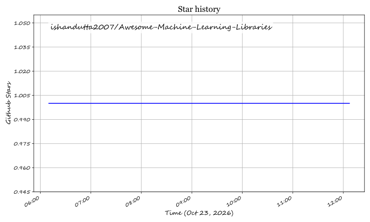

# 🚀 Awesome Machine Learning Libraries

### ⚡ The Ultimate Curated Ecosystem of Open-Source ML Frameworks, AutoML Platforms & Predictive SaaS Tools

  
  
  
  
  
  
  

  <b>A comprehensive directory of top-tier Machine Learning (ML), Deep Learning (DL), AutoML, Gradient Boosting, NLP, Computer Vision, and MLOps libraries.</b> 
  <i>Engineered for data scientists, machine learning engineers, AI researchers, and technical leaders building production-grade predictive intelligence.</i>

---

## 📌 Table of Contents

- [📊 Sector Overview & Market Dynamics](#-sector-overview--market-dynamics)
- [☁️ SaaS & Hosted Enterprise ML Platforms](#️-saas--hosted-enterprise-ml-platforms)
- [🔥 Open-Source Machine Learning Libraries](#-open-source-machine-learning-libraries)
  - [Top Open-Source Repositories (Ranked by GitHub_Stars)](#top-open-source-repositories-ranked-by-github-stars)
- [🤝 How to Contribute](#-how-to-contribute)
- [💖 Support & Sponsorship](#-support--sponsorship)
- [📈 Star History](#-star-history)
- [⚖️ Disclaimer](#️-disclaimer)

---

## 📊 Sector Overview & Market Dynamics

The global machine learning platforms and Automated Machine Learning (AutoML) market is estimated at **$3.7B–$6.8B for AutoML** (and **$135B+ for the broader ML platform ecosystem**) in 2026, advancing at a compound annual growth rate (CAGR) exceeding 35%. 

The sector exhibits a bifurcated market structure:
- **Core Cloud Infrastructure**: It is **highly concentrated** at the base compute and managed cloud ML platform layer, heavily dominated by hyperscalers (Microsoft Azure, Alphabet Google Cloud, and Amazon AWS).
- **Specialized Application Tier**: It remains **moderately fragmented** across specialized enterprise AutoML, automated feature engineering, LLM inference engines, and predictive analytics vendors catering to targeted industry verticals and self-hosted workflows.

---

## ☁️ SaaS & Hosted Enterprise ML Platforms

| Product | Company Scale (Valuation / Revenue) | Description | Pricing | Free Tier Limit |
| :--- | :--- | :--- | :--- | :--- |
| **[Azure Automated ML](https://azure.microsoft.com/en-us/products/machine-learning/automatedml)** | **~$3.1T Market Cap** (Microsoft parent; $245B+ ARR) | Microsoft's AutoML service within Azure Machine Learning. | **$0.02/hour** compute entry (pay-as-you-go; AutoML software tools included with Azure ML compute). | **$200 credit** (30-day trial) + free monthly quota of select Azure services (e.g., 750 hours of B1s VMs for 12 months). |
| **[Google Cloud AutoML](https://cloud.google.com/automl)** | **~$2.1T Market Cap** (Alphabet parent; $350B+ revenue) | Google's managed AutoML for tabular, vision, and text workflows. | **$21.50/hour** for tabular model training ($0.056/hour for minimal Vertex AI compute endpoints). | **$300 free credits** (valid for 90 days) across GCP services; no permanent free AutoML training. |
| **[AWS SageMaker](https://aws.amazon.com/sagemaker/)** | **~$2.0T Market Cap** (Amazon parent; AWS $105B+ ARR) | End-to-end ML platform with built-in algorithms, AutoML (Autopilot), and deployment. | **$0.05/hour** (entry compute via `ml.t3.medium` instances; pay-as-you-go). | **2-month free trial**: 250 hours/month of `ml.t2.medium`/`ml.t3.medium` notebooks, 50 hours of `ml.m4.xlarge` training, and 125 hours of `ml.m4.xlarge` hosting. |
| **[DataRobot](https://www.datarobot.com/)** | **$6.3B Valuation** ($225M–$285M ARR) | Automated ML platform with AutoML, MLOps, and generative AI capabilities. | **~$40,000/year** entry-level enterprise tier (~$3,333/month equivalent via custom contract). | **14-day free trial** with full platform capabilities upon sales verification; no permanent free tier. |
| **[Dataiku](https://www.dataiku.com/)** | **$3.7B Valuation** ($350M+ ARR) | Collaborative data science platform with visual and code-based workflows. | **~$4,000/month** (~$48,000/year entry commercial package). | **14-day Cloud Trial** (5 users, 4 CPUs, 32 GB compute) or **Free Edition** on-premises (limited to 3 users, community support). |
| **[H2O.ai](https://h2o.ai/)** | **$1.7B Valuation** (~$75M ARR) | Enterprise AI platform with Driverless AI (AutoML) and the open-source H2O-3 library. | **$250,000/year** starting enterprise license via cloud marketplaces. | **21-day free trial** of Driverless AI; or permanent **H2O-3 Open Source** (100% free under Apache 2.0). |
| **[Pecan AI](https://www.pecan.ai/)** | **$117M Funding** (~$10M ARR) | Predictive analytics platform focused on revenue and customer lifecycle predictions. | **~$950/month** entry-level prediction plan (Starter tier billed annually). | **14-day guided proof-of-concept / sandbox trial** via sales demo; no permanent free tier. |
| **[dotData](https://dotdata.com/)** | **$74.6M Funding** (~$15M–$25M ARR est.) | Automated feature engineering and predictive analytics platform. | **¥50,000/month** (~$330/month) for dotData Insight Lite (Japanese SMB tier). | **14-day evaluated trial / pilot** upon request; no permanent free tier. |
| **[Akkio](https://www.akkio.com/)** | **$60M Valuation** ($18M total funding) | AI-native analytics and predictive modeling platform for agencies. | **$49/month** (Starter self-serve plan; scaling to enterprise packages). | **14-day free trial** (access to core predictive models and data connectors; no credit card required). |
| **[BigML](https://bigml.com/)** | **$6.6M Funding** (~$5M–$10M ARR) | Machine learning platform with a focus on ease of use and private deployments. | **$30/month** (Standard plan; 64 MB task size, 2 parallel tasks). | **Free forever plan**: max **16 MB** dataset/task size, max 2 parallel tasks, unlimited non-commercial runs. |

---

## 🔥 Open-Source Machine Learning Libraries

This section curates the most impactful open-source machine learning, deep learning, NLP, computer vision, and MLOps libraries. All repositories are equipped with official badges linking directly to their stargazers page and are strictly sorted in **descending order by GitHub_Stars_Count**.

### Top Open-Source Repositories (Ranked by GitHub_Stars)

1. **[TensorFlow](https://github.com/tensorflow/tensorflow)**   
   **The production-scale deep learning standard.** ~201k+ stars, Apache 2.0 licensed. End-to-end open-source machine learning platform with extensive ecosystem tooling including Keras, TensorFlow Serving, TensorFlow Lite (for mobile and embedded devices), and TensorBoard for visualization. Best for large-scale enterprise production pipelines.

2. **[Transformers (Hugging Face)](https://github.com/huggingface/transformers)**   
   **State-of-the-art Machine Learning for Pytorch, TensorFlow, and JAX.** ~168k+ stars, Apache 2.0 licensed. Provides thousands of pretrained models to perform tasks on texts such as classification, information extraction, question answering, summarization, translation, text generation, and computer vision.

3. **[PyTorch](https://github.com/pytorch/pytorch)**   
   **The research-first deep learning framework.** ~105k+ stars, BSD-3-Clause licensed. Tensors and dynamic neural networks in Python with strong GPU/TPU acceleration. The foundation of modern generative AI, frontier LLM architectures, and cutting-edge deep learning research.

4. **[vLLM](https://github.com/vllm-project/vllm)**   
   **High-throughput and memory-efficient LLM inference and serving.** ~95k+ stars, Apache 2.0 licensed. State-of-the-art serving engine utilizing PagedAttention, continuous batching, and chunked prefill to achieve ultra-fast generation and maximum hardware utilization.

5. **[scikit-learn](https://github.com/scikit-learn/scikit-learn)**   
   **The classical machine learning gold standard.** ~68k+ stars, BSD-3-Clause licensed. Simple and efficient tools for predictive data analysis, classification, regression, clustering, dimensionality reduction, and preprocessing built on NumPy, SciPy, and matplotlib.

6. **[Keras](https://github.com/keras-team/keras)**   
   **High-level deep learning API for multi-backend execution.** ~64k+ stars, Apache 2.0 licensed. Seamlessly write code that runs with identical syntax on JAX, PyTorch, or TensorFlow. Exceptional for rapid prototyping and modular network building.

7. **[Ray](https://github.com/ray-project/ray)**   
   **Unified framework for scaling AI and Python applications.** ~44k+ stars, Apache 2.0 licensed. Provides distributed compute primitives and higher-level ML libraries (Ray Train, Ray Tune, Ray Serve, Ray Data) powering massive multi-node training and RLHF workloads.

8. **[DeepSpeed](https://github.com/deepspeedai/DeepSpeed)**   
   **Extreme-scale deep learning optimization library.** ~43k+ stars, Apache 2.0 licensed. Developed by Microsoft to make distributed training and inference efficient and easy, featuring ZeRO (Zero Redundancy Optimizer) memory optimization.

9. **[JAX](https://github.com/jax-ml/jax)**   
   **Composable transformations of Python+NumPy programs.** ~36k+ stars, Apache 2.0 licensed. Differentiate, vectorize, JIT-compile to GPU/TPU with XLA. Highly popular for modern scientific computing and frontier AI models.

10. **[spaCy](https://github.com/explosion/spaCy)**   
    **Industrial-strength Natural Language Processing in Python.** ~34k+ stars, MIT licensed. Designed specifically for production use, offering blazingly fast tokenization, POS tagging, named entity recognition (NER), dependency parsing, and transformer integration.

11. **[XGBoost](https://github.com/dmlc/xgboost)**   
    **Scalable, portable and distributed gradient boosting library.** ~29k+ stars, Apache 2.0 licensed. High-performance gradient boosting (GBDT, GBRT or GBM) running on CPU, GPU, and distributed environments like Spark, Dask, and Flink.

12. **[MLflow](https://github.com/mlflow/mlflow)**   
    **Open source platform for the complete machine learning lifecycle.** ~28k+ stars, Apache 2.0 licensed. Essential for experiment tracking, model evaluation, packaging, artifact versioning, and unified model registry across any ML framework.

13. **[LightGBM](https://github.com/lightgbm-org/LightGBM)**   
    **A fast, distributed, high performance gradient boosting framework.** ~19k+ stars, MIT licensed. Uses tree-based learning algorithms with histogram-based leaf-wise splitting for faster training speed, lower memory usage, and higher efficiency on massive tabular datasets.

14. **[Optuna](https://github.com/optuna/optuna)**   
    **Next-generation hyperparameter optimization framework.** ~15k+ stars, MIT licensed. Features lightweight dynamic search spaces, pruning algorithms (such as Hyperband/median), and seamless visualization dashboards.

15. **[AutoGluon](https://github.com/autogluon/autogluon)**   
    **Automated Machine Learning for tabular, text, image, and time-series data.** ~11k+ stars, Apache 2.0 licensed. Developed by AWS, it automates model selection, ensembling, feature engineering, and multi-layer stacking with state-of-the-art competitive performance.

16. **[PyCaret](https://github.com/pycaret/pycaret)**   
    **Low-code machine learning library in Python.** ~10k+ stars, MIT licensed. Replaces hundreds of lines of boilerplate code with just a few commands for data prep, model comparison, tuning, ensembling, and deployment.

17. **[CatBoost](https://github.com/catboost/catboost)**   
    **Fast, scalable, high-performance gradient boosting on decision trees.** ~9.2k+ stars, Apache 2.0 licensed. Superior native handling of categorical features, ordered boosting to mitigate target leakage, and out-of-the-box GPU acceleration.

18. **[BentoML](https://github.com/bentoml/BentoML)**   
    **The unified model serving and deployment framework.** ~8.9k+ stars, Apache 2.0 licensed. Package models from any ML/DL framework into high-performance, containerized microservices ready for cloud deployment with adaptive batching.

19. **[H2O-3](https://github.com/h2oai/h2o-3)**   
    **Open-source distributed in-memory machine learning platform.** ~7.5k+ stars, Apache 2.0 licensed. Scales to massive datasets across multi-node clusters with built-in AutoML, GLM, Random Forest, GBM, and Deep Learning with Python, R, and Java APIs.

---

## 🤝 How to Contribute

Contributions make the open-source community an inspiring place to learn, share, and build together! Any contributions you make are **greatly appreciated**.

1. 🍴 **Fork the Project**
2. 🌿 **Create your Feature Branch** (`git checkout -b feature/AmazingLibrary`)
3. 💾 **Commit your Changes** (`git commit -m 'Add new open-source ML library'`)
4. 🚀 **Push to the Branch** (`git push origin feature/AmazingLibrary`)
5. 📬 **Open a Pull Request** with a concise description of the library, category, Stars_Count, and license.

---

## 💖 Support & Sponsorship

If you find this repository valuable for your research, team, or production pipelines, please consider showing your support:

- 🌟 **Star this repository** to help others discover it!
- 🍴 **Fork it** and add your favorite machine learning libraries.
- 📢 **Share it** on X / LinkedIn / Reddit with your data science network.
- ☕ **Support future development & maintenance**:  
    
  Visit the [GitHub Sponsor Dashboard](https://github.com/sponsors/ishandutta2007) to back open-source curation and maintenance!

---

## 📈 Star History

---

## ⚖️ Disclaimer

- **Community Curated**: This is an independent, community-driven resource. Project inclusions, Stars_Counts, and pricing benchmarks reflect active public intelligence and do not constitute formal commercial endorsements.
- **Enterprise SaaS Pricing**: Enterprise ML SaaS pricing is frequently customized based on consumption, active deployments, and compute tiers; always contact respective sales organizations for binding quotes.
- **Library Selection Guide**: Tabular modeling & predictive regression/classification $
ightarrow$ `scikit-learn`, `XGBoost`, `LightGBM`, `CatBoost`; Foundation Deep Learning $
ightarrow$ `PyTorch`, `TensorFlow`, `JAX`; High-Throughput LLM Serving $
ightarrow$ `vLLM`, `DeepSpeed`, `BentoML`; End-to-End AutoML $
ightarrow$ `AutoGluon`, `PyCaret`, `H2O-3`.

  Built with ❤️ for data scientists, ML engineers, and researchers worldwide.

## ⭐ Star History

<a href="https://star-history.com/#ishandutta2007/Awesome-Machine-Learning-Libraries&Timeline" align="center">
  <picture>
    <source media="(prefers-color-scheme: dark)" srcset="assets/ishandutta2007_Awesome-Machine-Learning-Libraries_growth.svg">
    
  </picture>
</a>
